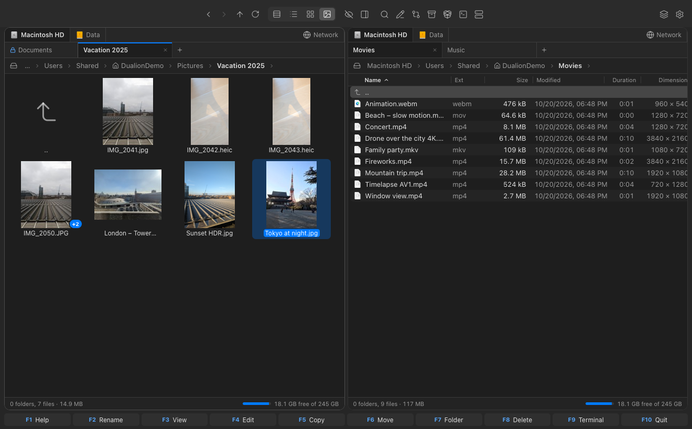
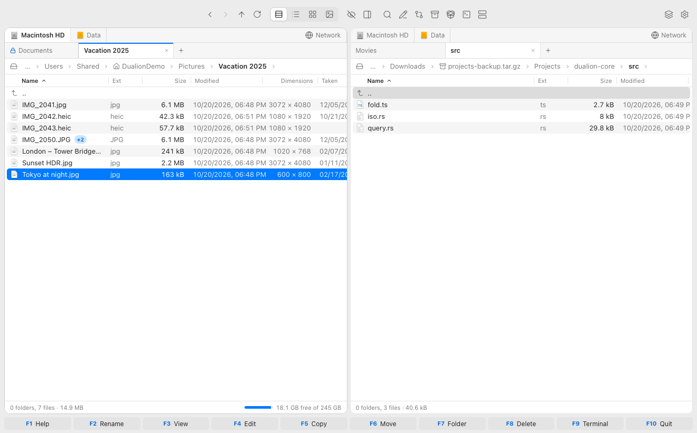
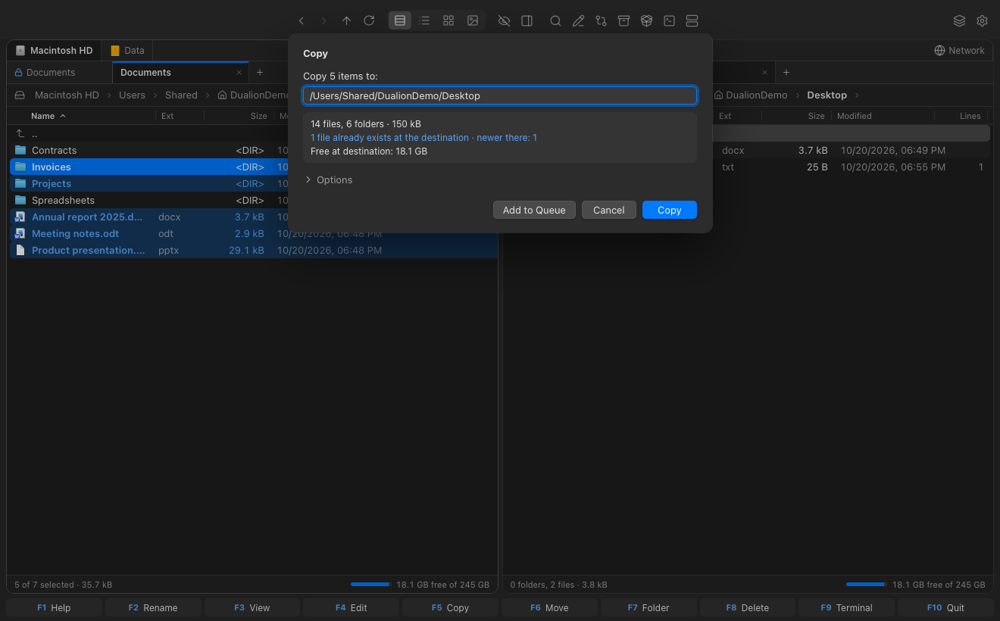
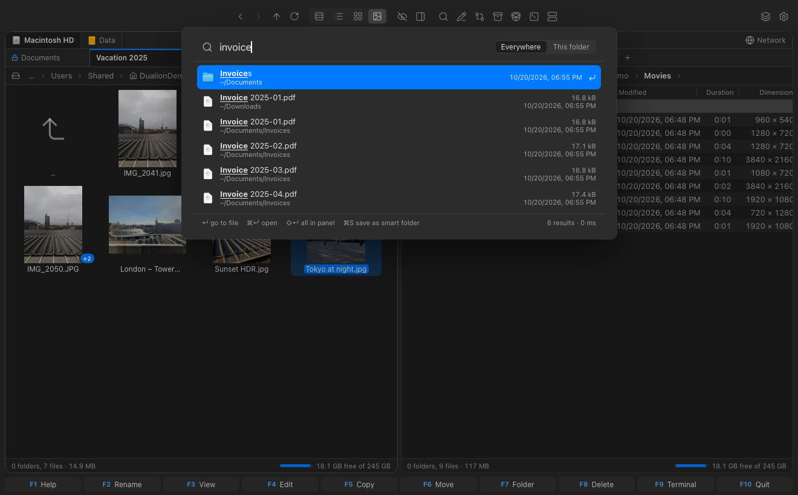
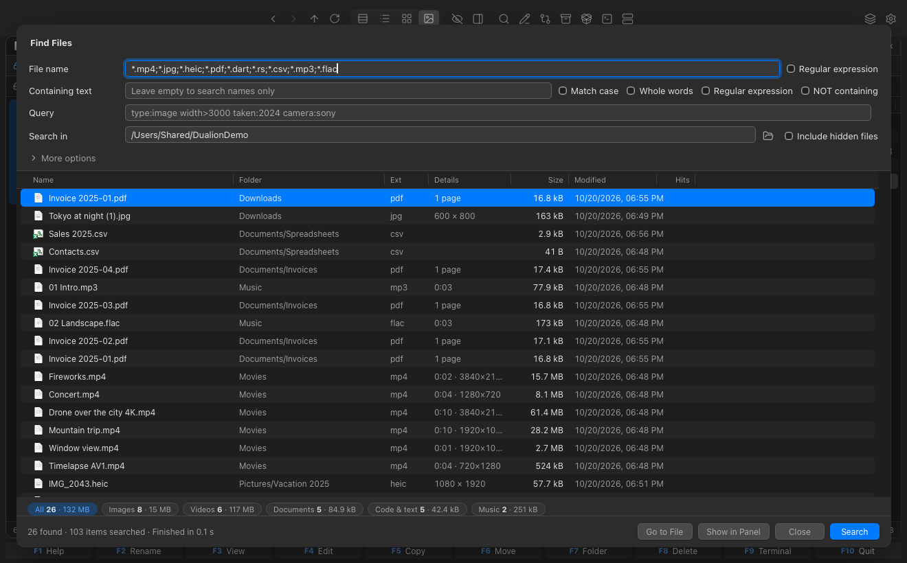
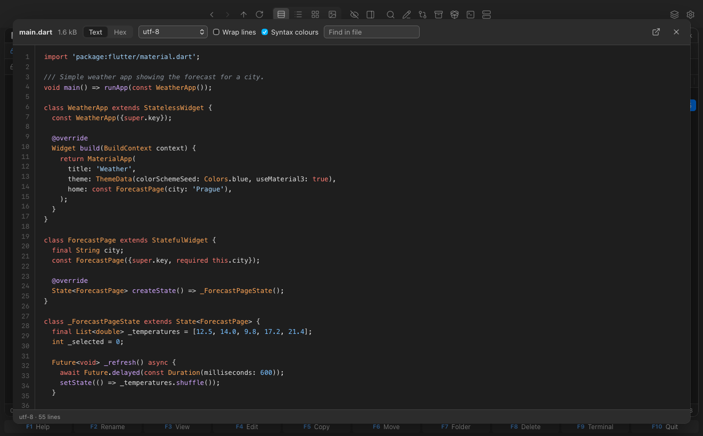
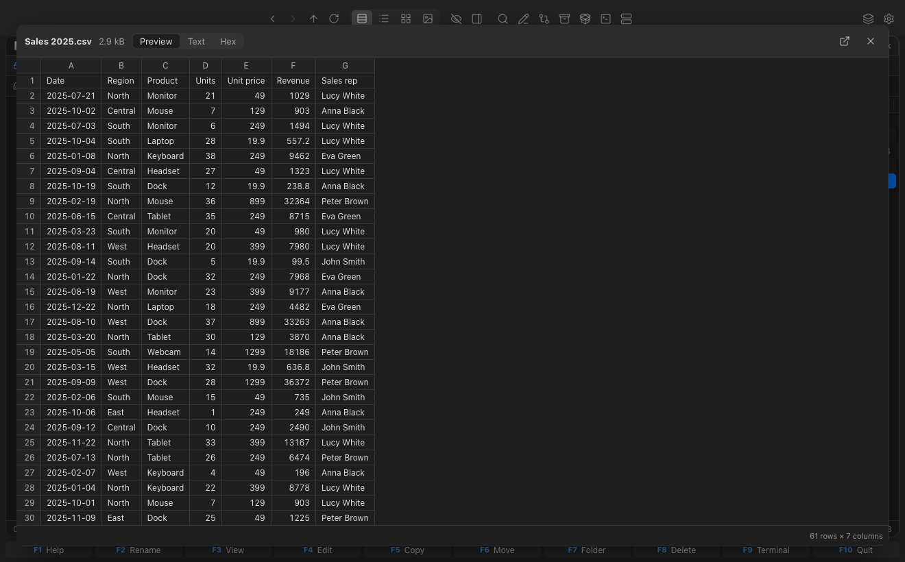
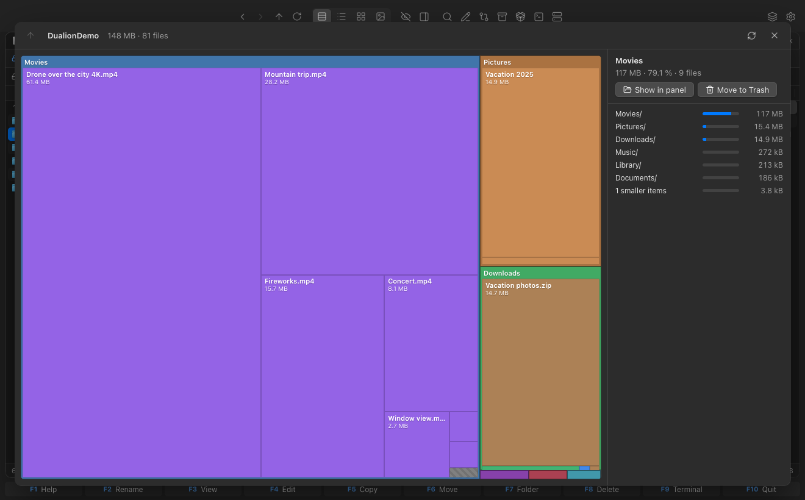
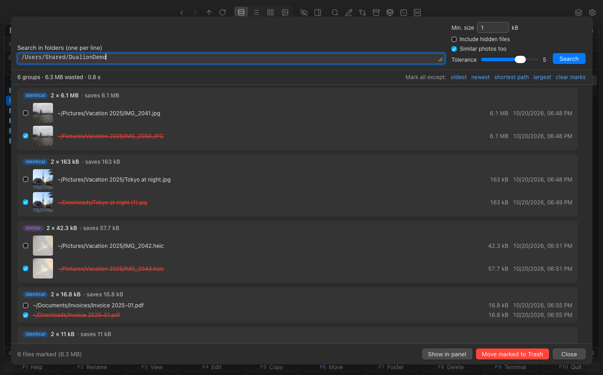
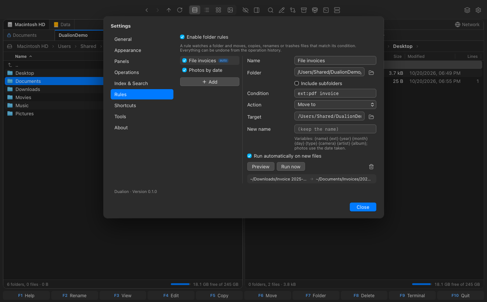

# Dualion

[Česky](README.cs.md) · **English**

A fast dual-pane file manager for **Windows** and **macOS** in the spirit of Total Commander. It looks native on each system and adds an operation queue, instant search over a file index, previews for dozens of formats, archives with password support, FTP/FTPS with an encrypted vault, and an English and Czech UI.

Author: **Haluška** · Community: [Discord](https://discord.com/invite/DjnKfuYYgN)



## Contents

- [Panes and navigation](#panes-and-navigation)
- [Views and columns](#views-and-columns)
- [File operations](#file-operations)
- [Undo, history and dry run](#undo-history-and-dry-run)
- [Search](#search)
- [Previews and the F3 viewer](#previews-and-the-f3-viewer)
- [Archives and disk images](#archives-and-disk-images)
- [FTP / FTPS and password vault](#ftp--ftps-and-password-vault)
- [Tools](#tools)
- [Cloud folders](#cloud-folders-onedrive-icloud-dropbox)
- [Appearance, language and settings](#appearance-language-and-settings)
- [Keyboard shortcuts](#keyboard-shortcuts-defaults)
- [Building, tests, architecture](#building)
- [License](#license)

## Features

### Panes and navigation

- **Two panes with tabs.** You can open a new tab, duplicate a tab or close the others. Drag tabs to reorder them and middle-click to close one. The tab strip sits flush with the pane edges, and the active tab of the active pane has a blue accent line.
- **Locked tabs** always stay on the left. Opening another folder from a locked tab opens it in a new tab, as in TC.
- **Drive bar** above each pane, which you can turn off:
  - drives with native icons, with the current drive highlighted;
  - each drive remembers the last folder you used on it;
  - middle-click opens a drive in a new tab;
  - the **Network** button lists saved FTP servers and network volumes.
- **Breadcrumbs:**
  - click a segment to go to that folder;
  - click the chevron between segments to list subfolders;
  - click after the last segment to type a path with autocomplete. Typing accepts `~`, `$HOME`, `%USERPROFILE%` and relative paths. A path to a file opens its folder and selects the file.
- **More navigation:**
  - places (Home, Desktop, Documents, Downloads…) and a **favourites hotlist**;
  - back/forward history and the ".." entry;
  - hidden files;
  - "This PC" / "Drives" with free space.
- **Quick search by typing**, which either jumps to or filters matching items, and a pane **quick filter** that accepts a `*.jpg` mask or the query language.
- **Quick View panel** in the opposite pane.
- **Folders and sessions:**
  - folders refresh live when files change on disk;
  - your tabs, folders and views come back after a restart.
- **TC-style marking:**
  - Insert / Space marks files;
  - Num + / − / * select by mask or invert the selection;
  - you can select every file with the same extension;
  - clicking does not clear marks;
  - Ctrl/⌘+click and Shift+click work as in Finder and Explorer.
- Drag & drop between panes and to/from Finder and Explorer.



### Views and columns

- **View modes:**
  - **details**;
  - **list**, a column flow like TC's "Brief" view;
  - **large icons**;
  - **thumbnails**, with an adjustable size.
- **Native file icons** (the same as Finder and Explorer), plus thumbnails for images, videos, PDFs, documents, PSD, Affinity and RAW files, album art and more.
- **Resizable columns:** drag the handle on a column's right edge (this works on Name too). Double-click the handle to reset the width. Widths are remembered.
- **Metadata columns:**
  - available columns include dimensions, date taken, camera, lens, ISO, aperture, exposure, focal length, GPS, duration, codec, FPS, bitrate, artist, album, track, year, genre, sample rate, page count, author, document title and line count;
  - columns are **picked automatically from the folder's content** (photos, video, music, documents or code);
  - right-click the header to customise the columns for that folder;
  - you can sort by any metadata column.
- **File groups:**
  - related files are shown as one item with a "+N" badge, which you can expand;
  - examples: `icon.png` + `icon.psd` + `icon.ico`; `IMG_1.CR2` + `IMG_1.JPG` + `IMG_1.CR2.xmp`; `movie.mkv` + `movie.en.srt`; `photo.jpg.json`;
  - a group is copied, moved, renamed and deleted together.
- **Name wrapping** over 1–3 lines (default: 1 line).
- **Sorting:**
  - by name (natural, locale-aware), extension, size, date or any metadata column;
  - folders always stay on top.
- Lists are virtualised, so folders with hundreds of thousands of files still scroll smoothly.

### File operations

- **Basic operations:**
  - copy and move;
  - delete to the trash or permanently;
  - in-place rename;
  - new folder (including nested `a/b/c`) and new file;
  - duplicate (Shift+F5);
  - symbolic link.
- **Clipboard:** cut, copy and paste files, and copy a file's path, the folder's path or the name.
- **Operation queues:**
  - start a job immediately or add it to one of three queues, which run jobs one after another;
  - pause, resume or cancel a job, run it outside the queue, or reorder the queue;
  - progress shows speed and time remaining.
- **Conflict handling:**
  - replace, skip, keep both or replace older, with an "apply to all" option;
  - retry after an error, or skip the failing files.
- **Fast copying:**
  - APFS cloning on macOS, which is instant;
  - `CopyFileExW` on Windows.
- **Copy options:**
  - optional checksum verification;
  - preserving timestamps;
  - a speed limit;
  - a mask filter (`*.jpg;*.png | thumb*`).
- **Multi-rename** with a live preview:
  - placeholders `[N] [N2-5] [E] [C] [Y][M][D] [h][m][s] [P]`;
  - find/replace, including regex;
  - case conversion.
- **Opening and external tools:**
  - open, or open with another app;
  - reveal in Finder or Explorer;
  - properties;
  - Quick Look on macOS;
  - an editor on F4 and a terminal on F9, both configurable.

### Undo, history and dry run

- **Universal undo** (⌘Z / Ctrl+Z) and **operation history** (⌘⇧Z):
  - you can undo copy, move, delete to trash, pack, extract, new folder, new file, rename, and changes made by rules;
  - undoing a creation sends the created items to the trash;
  - undoing a move puts the items back;
  - undoing a delete restores the items from the trash.
- **Dry run before an operation:**
  - the copy/move dialog shows file and folder counts, the total size, conflicts (newer in the target, or identical) and whether the target has enough space;
  - the delete confirmation shows a summary and whether the delete can be undone.



### Search

- **Instant search** (⌘P / Ctrl+P) over a **file index**, Everything-style:
  - hundreds of thousands of files are kept in memory, and results appear in milliseconds as you type;
  - matching ignores diacritics;
  - the index is saved to disk and updated live through FSEvents (macOS) or ReadDirectoryChangesW (Windows);
  - media metadata is filled in in the background;
  - in Settings you choose indexed folders, excluded folders, and whether to include hidden files and metadata;
  - from the results you can go to a file, open it, send all results to a pane, or save the search as a **smart folder**;
  - an "Everywhere / In this folder" switch limits the scope.
- **Query language** in the pane filter, instant search and the Find dialog:
  - examples: `invoice ext:pdf modified:2025`, `type:video res>=4k duration>10m codec:hevc`, `type:image camera:canon taken:2024 -ext:heic`, `size:1g..4g`, `artist:"Daft Punk"`, `orient:portrait`, `gps:yes`, `content:"text"`;
  - operators: `(a | b)` and `NOT`;
  - Czech aliases are accepted too.
- **Smart folders:** a saved query appears as a folder in favourites and is re-evaluated every time you open it.
- **Natural-language and semantic search.** This is optional and runs fully locally through Ollama; nothing leaves your computer.
  - Examples: `?find all .dart files`, `?videos larger than 1 GB from last year`, `?invoice for the domain example.com`.
  - The sentence is turned into filters by a language model (e.g. `gemma3:4b`) or by built-in English and Czech rules.
  - The topic is matched by meaning against document contents, including PDFs, with an embedding model (e.g. `embeddinggemma`).
  - The window shows how your query was understood.
  - Optionally, photo captions can come from a vision model.
- **Command palette** (⌘⇧P / Ctrl+Shift+P) with fuzzy search over every action.
- **Find in files** (Alt+F7), powered by the ripgrep engine:
  - **name:** mask or regex;
  - **content:** regex, case sensitivity, whole words and "does not contain". Supported encodings include Windows-1250, which is detected automatically.
  - **other filters:** metadata query, size, date, depth, excluded folders, `.gitignore`, hidden files and symlinks;
  - **results table** with sortable, resizable columns: name with the matching line, folder, extension, detail (dimensions, duration or pages), size, date and match count;
  - a **summary by type** above the table also works as a filter;
  - the results can be sent to a pane.





### Previews and the F3 viewer

- **F3 viewer** and **Quick View** show:
  - **text:**
    - encoding detection (UTF-8/16, Windows-1250, ISO-8859-2, CP852, KOI8-R, Shift_JIS, GBK…);
    - word wrap and search;
    - big files load in chunks;
    - hex mode;
  - **syntax highlighting** with line numbers in 40 languages, including Dart, JSON, HTML/XML, PHP, CSS/SCSS/Less, Rust, JavaScript/TypeScript, Python, Java, Kotlin, Swift, Go, C/C++, C#, SQL, Shell, PowerShell, YAML, TOML/INI, Markdown, Dockerfile, Makefile, Gradle, Ruby, Lua, Perl, R, Scala, Haskell, Elixir and GraphQL;
  - **media:** images with zoom, video, audio with album art, and PDF;
  - **spreadsheets** (`.xls`, `.xlsx`, `.xlsm`, `.xlsb`, `.ods`, `.csv`, `.tsv`) with sheets and headers;
  - **documents** (`.doc`, `.docx`, `.odt`, `.rtf`) with headings, lists and tables;
  - **presentations** (`.pptx`, `.odp`) with slides;
  - **font specimens** (`.ttf`, `.otf`, `.woff`, `.woff2`);
  - **design files:**
    - **PSD/PSB** rendering without Photoshop;
    - **Affinity** files (`.af`, `.afphoto`, `.afdesign`, `.afpub`);
    - **RAW** photos;
    - Clip Studio, Krita, OpenRaster, Sketch, Procreate, XMind, 3MF, iWork and EPUB.
- **Thumbnails:**
  - sources: ImageIO and QuickLook on macOS, the Windows shell, and custom decoders;
  - thumbnails are cached in memory and on disk.





### Archives and disk images

- **Browse archives like folders, preview their files and extract them.** Supported formats:
  - ZIP, including `.jar`, `.apk`, `.epub`, `.cbz` and similar;
  - **7z**;
  - **RAR** (RAR4 and RAR5);
  - **ISO** (ISO 9660 / Joliet);
  - **TAR** and `.tar.gz` / `.tgz`, `.tar.bz2`, `.tar.xz`, `.tar.zst`;
  - standalone `.gz`, `.bz2`, `.xz` and `.zst`.
- **Password-protected archives:**
  - ZIP (AES and ZipCrypto), 7z (AES-256, including encrypted names) and RAR;
  - you are asked for the password when you open or extract the archive;
  - the password is kept only in memory.
- **Packing:**
  - ZIP and 7z, optionally with AES-256 password protection; 7z can also encrypt file names;
  - TAR, `.tar.gz`, `.tar.bz2`, `.tar.xz` and `.tar.zst`;
  - you choose the compression level.
- **Mounting disk images** (ISO, DMG, VHD…) through the system: `hdiutil` on macOS, `Mount-DiskImage` on Windows.

### FTP / FTPS and password vault

- **FTP and FTPS:**
  - explicit and implicit TLS;
  - passive and active mode;
  - name encodings, including Windows-1250;
  - you browse a server like a folder and copy in both directions through the queue.
- **Encrypted vault for saved logins:**
  - encrypted with **XChaCha20-Poly1305**;
  - the key is stored in the macOS Keychain or Windows Credential Manager, or derived from a master password with Argon2id;
  - passwords never leave the backend.

### Tools

- **Disk usage map** (treemap):
  - click into folders;
  - a list of the largest items;
  - delete to the trash.
- **Duplicates:**
  - identical files are found by content: size first, then a quick fingerprint, then a full hash. The file index is reused where possible.
  - **similar photos** are found with a perceptual hash;
  - auto-mark all copies except the oldest, newest, shortest path or largest;
  - delete to the trash, which can be undone;
  - send the results to a pane.
- **Folder rules**, similar to Hazel:
  - example: "move PDF invoices from Downloads to `Documents/Invoices/{year}/{month}`";
  - conditions are written in the query language;
  - actions are move, copy, rename or move to trash;
  - name templates: `{name} {ext} {year} {month} {day} {type} {camera} {artist} {album}`;
  - preview a rule before running it;
  - run rules manually or automatically on new files;
  - an activity log is kept, and everything can be undone.
- **Other tools:**
  - **checksums** (MD5, SHA-1, SHA-256, SHA-512, CRC32, XXH3);
  - **folder compare**;
  - **folder size calculation**;
  - symbolic links.







### Cloud folders (OneDrive, iCloud, Dropbox…)

- Online-only files are detected without downloading them and marked with a **cloud icon**. Windows uses the Files On-Demand attributes; macOS uses the *dataless* flag.
- These features **never download** online-only files automatically:
  - the index;
  - thumbnails and metadata;
  - Quick View;
  - content search;
  - duplicate finding;
  - semantic search.
- A file is downloaded only when you open it explicitly, or when you click "Download and preview".
- Cloud folders can be excluded from the index entirely. This covers all OneDrive accounts, Dropbox, Google Drive and iCloud.

### Appearance, language and settings

- **macOS:**
  - unified title bar with vibrancy and centred actions;
  - native menus and context menus;
  - the system accent colour.
- **Windows 11:**
  - Mica and Fluent styling;
  - an in-window menu bar: hover to switch menus, Alt, Alt+letter and arrow keys;
  - dialog buttons in Windows order;
  - no console window.
- **Display options:**
  - light, dark or system theme;
  - row density;
  - font size;
  - size format: auto, binary, decimal or bytes.
- **Language:**
  - **English and Czech**, defaulting to the system language;
  - Czech texts in the Windows installers too.
- **Custom keyboard shortcuts** (Settings → Keyboard shortcuts). Changes also appear in the menus and in the F1 help.
- **Help and about:**
  - F1 help with the shortcut list;
  - an About window with Discord and donation links.
- Every advanced feature can be turned off in Settings. This covers the drive bar, metadata columns, file groups, the index, rules and semantic search.

## Keyboard shortcuts (defaults)

| Key | Action | Key | Action |
|---|---|---|---|
| F1 | Help / shortcuts | F7 | New folder |
| F2, Shift+F6 | Rename | F8 | Delete (to trash) |
| F3 | View | Shift+F8 | Delete permanently |
| F4 | Edit | F9 | Terminal |
| Shift+F4 | New file | F10 | Quit |
| F5 | Copy | Alt+F7, Mod+F | Find in files |
| Shift+F5 | Duplicate | Alt+F1 / Alt+F2 | Drive left / right |
| F6 | Move | Alt+F5 / Alt+F9 | Pack / unpack |
| Tab | Switch pane | Mod+T / Mod+W | New / close tab |
| Insert, Space | Mark | Mod+Shift+L | Lock tab |
| Num + / − / * | Select by mask / invert | Mod+K | Connect to server |
| Mod+L | Type a path | Mod+M | Multi-rename |
| Mod+P | Instant search | Mod+Shift+P | Command palette |
| Mod+Z | Undo last operation | Mod+Shift+Z | Operation history |
| Mod+Shift+C | Copy file path | Mod+Alt+Shift+C | Copy folder path |
| Mod+Alt+C | Copy name | Mod+Alt+G | Group files |
| Mod+Alt+U | Disk usage | Mod+Alt+D | Duplicates |
| Mod+1 … 4 | Details / list / icons / thumbnails | Mod+Alt+L | Symbolic link |
| F12, Ctrl+Q | Quick View | | |

`Mod` is ⌘ on macOS and Ctrl on Windows. Press F1 in the app for the full list. You can change any shortcut in Settings.

## Building

You need [Rust](https://rustup.rs) (stable) and Node.js ≥ 20.19, plus:

- **macOS:** Xcode Command Line Tools (`xcode-select --install`).
- **Windows:** Visual Studio Build Tools with "Desktop development with C++", needed for UnRAR and zstd. WebView2 comes preinstalled on Windows 10/11, and the installer adds it if it is missing.

```bash
npm ci
npm run tauri dev      # development with hot reload
npm run tauri build    # installers
```

`npm run tauri build` produces:

- macOS: `src-tauri/target/release/bundle/macos/Dualion.app` and `bundle/dmg/Dualion_<version>_<arch>.dmg`
- Windows: `src-tauri/target/release/bundle/msi/Dualion_<version>_x64_cs-CZ.msi` and `bundle/nsis/Dualion_<version>_x64-setup.exe`

For a universal Mac build (Intel + Apple Silicon), run `npm run tauri build -- --target universal-apple-darwin`.

GitHub Actions (`.github/workflows/release.yml`) builds installers for both platforms when you push a `v*` tag.

To distribute the app beyond your own machine, sign it: Developer ID and notarization on macOS, Authenticode on Windows. The signing variables are documented in `release.yml`.

The optional AI features need [Ollama](https://ollama.com). You can download the models directly from Settings (e.g. `embeddinggemma` and `gemma3:4b`).

## Tests

```bash
npm test                      # frontend (Vitest): shortcuts, groups, treemap, syntax highlighting…
npm run check                 # type check (svelte-check)
cd src-tauri && cargo test    # backend: copying, queues, conflicts, archives, index, queries, metadata, vault, search…
```

Optional tests against external resources (`cargo test … -- --ignored`):

```bash
DUALION_FTP=127.0.0.1:2121 DUALION_FTPS=127.0.0.1:2122 cargo test ftp_e2e -- --ignored   # FTP (user jan, password tajne)
DUALION_RAR_DATA=<unrar-crate>/data cargo test rar -- --ignored                          # RAR including passwords
cargo test ollama -- --ignored                                                           # embeddings via Ollama
```

## Architecture

- `src-tauri/`: Rust backend (Tauri 2).
  - **Files and jobs:**
    - listings and volumes (`local.rs`);
    - the job queue and copy engine (`jobs/`);
    - undo and dry run (`jobs/undo.rs`, `jobs/plan.rs`).
  - **Archives, network and vault:**
    - archives (`arch/`: ZIP, 7z, RAR, ISO, TAR* and packing);
    - FTP (`ftp.rs`);
    - the encrypted vault (`vault.rs`).
  - **Search:**
    - find in files (`search.rs`);
    - the file index (`index/`);
    - the query language (`query.rs`);
    - sentences → queries (`ask.rs`);
    - semantic search (`semantic.rs`).
  - **Icons, previews and metadata:**
    - native icons and thumbnails (`icons/`, `thumbs.rs`);
    - custom preview decoders (`preview/`);
    - metadata (`meta/`);
    - the viewer (`viewer.rs`).
  - **Tools and platform:**
    - disk usage (`diskusage.rs`);
    - duplicates (`dupes.rs`);
    - rules (`rules.rs`);
    - tags (`tags.rs`);
    - the native menu (`menu.rs`);
    - folder watching (`watcher.rs`);
    - platform-specific code (`platform.rs`).
- `src/`: Svelte 5 + TypeScript frontend.
  - state for panes, tabs, the index and history (`lib/state/`);
  - commands and shortcuts (`lib/commands.ts`);
  - actions (`lib/actions.ts`);
  - columns and groups (`lib/columns.ts`, `lib/groups.ts`);
  - syntax highlighting (`lib/highlight.ts`);
  - components (`components/`);
  - translations (`lib/i18n/`).

Settings, sessions, the index and the vault are stored in the app's system folder:

- macOS: `~/Library/Application Support/cz.dualion.commander`
- Windows: `%APPDATA%\cz.dualion.commander`

## License

Copyright © 2026 Haluška. Dualion is free software, licensed under the [GNU General Public License v3.0](LICENSE) or (at your option) any later version.

You may use, study, modify and share it. If you distribute a modified version, you must release its source code under the same license.

## Support development

Dualion is free. If it helps you, you can support it:

- [Revolut](https://revolut.me/lukas399?note=Dualion)
- [PayPal](https://www.paypal.com/donate/?hosted_button_id=9QY42AUNSBRWE)
- BTC: `bc1qvfxwdqk9qp02tnnzvxtcd8sq5z7umud07xul33`
- ETH: `0x9B14c9f5c8A7891e43ff318DeAC7da1C213a4BAC`
